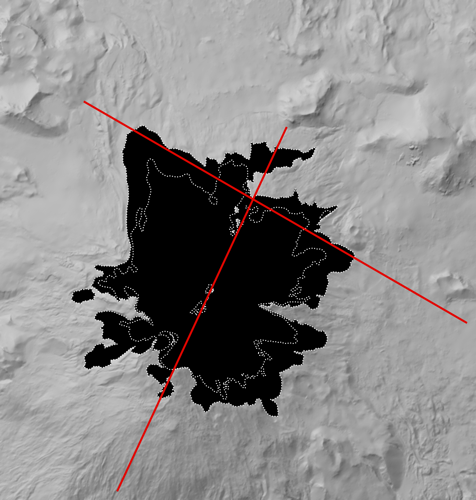

# Snæfellsjökull cross-sections: final

`snaefellsjokull_lines_map.png` (600 dpi): hillshaded terrain; in black, the area the glacier covered in 1999 or 2025; dotted white lines, the 1999 and 2025 outlines (the inner one is 2025); in red, the two section lines. North is up; the map is 7.9 × 8.3 km.

| Line | Description | Ice along the line, 1999 → 2025 | |
|---|---|---|---|
| `ssw_nne_summit` | South-south-west to north-north-east through the summit, across the south tongue and the north-east lobe | 3.99 → 2.40 km (-40%) | [details](../ssw_nne_summit/README.md) |
| `wnw_ese_north_flank` | West-north-west to east-south-east across the north flank | 4.25 → 1.16 km (-73%) | [details](../wnw_ese_north_flank/README.md) |

## Figures (400 dpi)

| File | Shows |
|---|---|
| `ssw_nne_summit_combined.png` | 2014 ice, both ELA lines, with the locator map |
| `ssw_nne_summit_combined_ice_columns.png` | the 1999 section (1990 ELA) with the 2025 section (2026 ELA) stacked on top; the 1999 columns run up through the 2025 section to the top edge |
| `ssw_nne_summit_1990s.png` | 1999 ice, 1990 ELA, with the locator map |
| `ssw_nne_summit_1990s_ice_columns.png` | 1999 ice, 1990 ELA; grey columns rise from the ice to the top edge |
| `ssw_nne_summit_2026.png` | 2025 ice, 2026 ELA, with the locator map |
| `ssw_nne_summit_2026_ice_columns.png` | 2025 ice, 2026 ELA; grey columns rise from the ice to the top edge |
| `wnw_ese_north_flank_combined.png` | 2014 ice, both ELA lines, with the locator map |
| `wnw_ese_north_flank_combined_ice_columns.png` | the 1999 section (1990 ELA) with the 2025 section (2026 ELA) stacked on top; the 1999 columns run up through the 2025 section to the top edge |
| `wnw_ese_north_flank_1990s.png` | 1999 ice, 1990 ELA, with the locator map |
| `wnw_ese_north_flank_1990s_ice_columns.png` | 1999 ice, 1990 ELA; grey columns rise from the ice to the top edge |
| `wnw_ese_north_flank_2026.png` | 2025 ice, 2026 ELA, with the locator map |
| `wnw_ese_north_flank_2026_ice_columns.png` | 2025 ice, 2026 ELA; grey columns rise from the ice to the top edge |

All sections are at true scale (a metre up is as long as a metre across), with the ice in black on the rock mesh, seen from the side where the ground falls away and with the start of the line on the left. In the `_ice_columns` figures nothing is exaggerated: above every stretch of ice, a grey column rises straight up to the top edge of the image, marking where the glacier is along the line. A line's column figures share the same frame and rock, so they line up. In `_combined_ice_columns` the 1990s section sits at the bottom and the 2026 section directly on top of it; the 1990s columns carry on straight up through the 2026 section, and the columns are see-through, so where the 1990s and 2026 ice overlap the grey is darker. Where only the lighter 1990s column passes through the 2026 section, the ice has gone.

## The ELA lines on the north flank

The `wnw_ese_north_flank` line misses the summit and crosses only the north flank, which tops out at about 1,017 m. The 2026 ELA (1,124 m) is **above all of the ice on this line**, and the 1990 ELA (962 m) is near its top. That's real, not an error: the ELA is one height for the whole glacier, and all of the ice on this line lies below it. This part of the glacier is in the zone that loses ice every summer and gains none, which is why the ice along this line shrank by 73% since 1999. The ice that is left there survives because it is fed by ice flowing down from higher up and hasn't finished melting yet.

See `../README.md` and each line's folder for how the ice thickness and the ELA lines are estimated.
