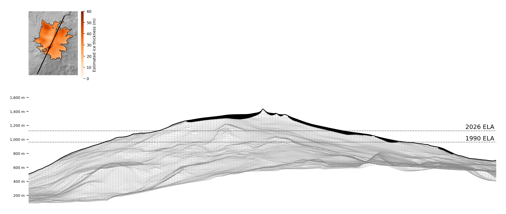

# Snæfellsjökull cross-section: south-south-west to north-north-east through the summit, across the south tongue and the north-east lobe

## The line

- From **64.7750° N, 23.8039° W** (left edge of the figures, the south-south-west end) to **64.8310° N, 23.7544° W** (right edge, the north-north-east end).
- 6.7 km long. The figures look **west-north-west** across the line: the mesh is the terrain up to 4.5 km behind it, in that direction.
- Drawn at true scale: a metre up is as long as a metre across.

## How much the ice has shrunk along this line

Between 1999 and 2025, the ice along this line went from **3.99 km to 2.40 km (-40%)**. Since ~1890 it went from 5.29 km (-55%).

| Outline year | Ice along the line (km) | Mapped from |
|---|---|---|
| ~1890 | 5.29 | geomorphology |
| 1945 | 4.68 | AMS aerial images |
| 1979 | 4.59 | aerial images NLSI |
| 1999 | 3.99 | aerial images Loftmyndir ehf |
| 2008 | 3.12 | lidar |
| 2014 | 3.12 | ArcticDEM |
| 2017 | 2.95 | Aerial images Loftmyndir ehf |
| 2019 | 2.89 | Sentinel-2A |
| 2021 | 2.90 | Sentinel-2A |
| 2023 | 2.66 | Sentinel-2A |
| 2025 | 2.40 | Sentinel-2A |

Outlines: Veðurstofa Íslands (Icelandic Met Office), CC BY 4.0. The ~1890 outline is reconstructed from the moraines the glacier left at its Little Ice Age maximum.

## Files

| File | Ice drawn | ELA lines |
|---|---|---|
| `snaefellsjokull_cross_section.png` | 2014 (the year that matches the DEM's surface) | 1990 and 2026 |
| `snaefellsjokull_cross_section_1990s.png` | 1999 (the outline closest to the 1990s) | 1990 |
| `snaefellsjokull_cross_section_2026.png` | 2025 (the newest outline) | 2026 |
| `snaefellsjokull_cross_section.csv` | The profile every 10 m: DEM surface, estimated rock bed, and ice thickness for each year drawn | |

The three figures share one vertical range and one thickness colour scale, so they can be laid side by side. The rock bed and the mesh are the same in all three; only the ice changes.

| Figure | Ice year | Ice along the line (km, on the DEM grid) | Thickest (m, estimate) |
|---|---|---|---|
| combined | 2014 | 3.12 | 69 |
| 1990s | 1999 | 3.99 | 73 |
| 2026 | 2025 | 2.43 | 63 |

## The two dotted lines

Both are the **equilibrium line altitude (ELA)**: the height where a year's snowfall and melt cancel out. Above it the glacier gains ice, below it, it loses ice. Both are worked out the same way, as *the height with a certain share of that year's glacier above it*, read off the DEM. They differ in where the share comes from.

- **1990 ELA ≈ 962 m.** The height with 58% of the 1999 glacier above it. That share is *assumed*: about 58% of a glacier's area lies above its ELA when it is in balance (neither growing nor shrinking), and Snæfellsjökull was close to balance in the 1990s.
- **2026 ELA ≈ 1,124 m.** The height with 40% of the 2025 glacier above it. That share is *measured*: it's the part of the glacier still under snow at the end of summer, on the Sentinel-2 image of 2026-09-08. Snow that survives the summer is the part of the glacier that gained ice that year.

The line rose by about 162 m, and the share of the glacier above it fell from 58% to 40%. That is why the glacier keeps shrinking: most of it now sits where it loses ice every summer. If the line rises above the summit (~1,440 m), no snow can survive anywhere and the ice cap will disappear.

No *measured* ELA exists for Snæfellsjökull (it has no mass-balance stakes). For comparison, the measured balance ELA of Langjökull, ~150 km east, is 1,000–1,200 m.

## How the ice thickness is estimated

Snæfellsjökull's thickness was measured once, by radar in 2003: ~30 m on average, 60–90 m in the outlet tongues. No map of the bed was published, so the thickness here is an estimate from a standard rule of glacier physics ("perfect plasticity"): ice flows under its own weight, so it is thin where the surface is steep, thick where it is gentle, and thins to zero at the edge. The one unknown (the stress at which ice flows, τ ≈ 68 kPa) is set so the average thickness of the 2014 glacier is 30 m. Treat thicknesses as ±50%.

The rock bed is the DEM minus the 2014 ice. The 1990s and 2026 figures put that year's ice, estimated the same way, on the same bed, so they show where the ice was, not the exact height of its surface then.

## Sources

- Surface: ÍslandsDEM v1.0 (10 m), Landmælingar Íslands, built from ArcticDEM; a blend of ~2008–2020 surfaces.
- Outlines: Veðurstofa Íslands (Icelandic Met Office) national glacier inventory, CC BY 4.0.
- Snow cover: Copernicus Sentinel-2.
- Radar thickness and the 1990s balance: Jóhannesson et al. (2011), *Jökull* 61. Langjökull ELA: Hannesdóttir et al. (2020), *Jökull* 70.

Made by `../../cross_section.ipynb`.
